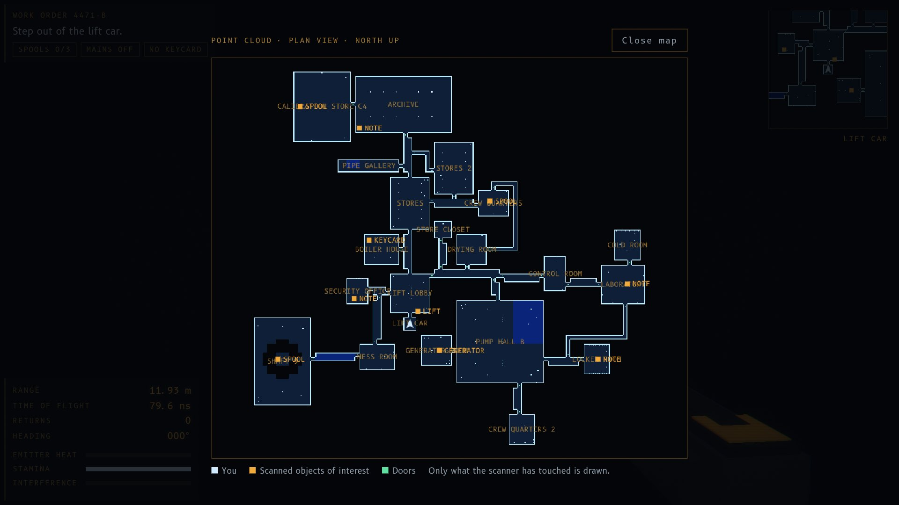
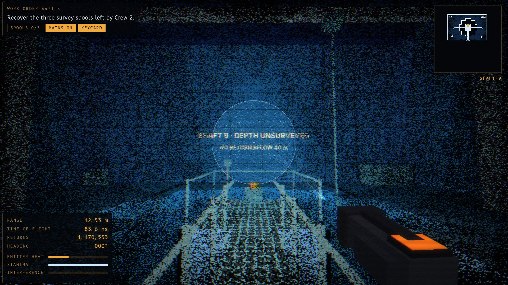
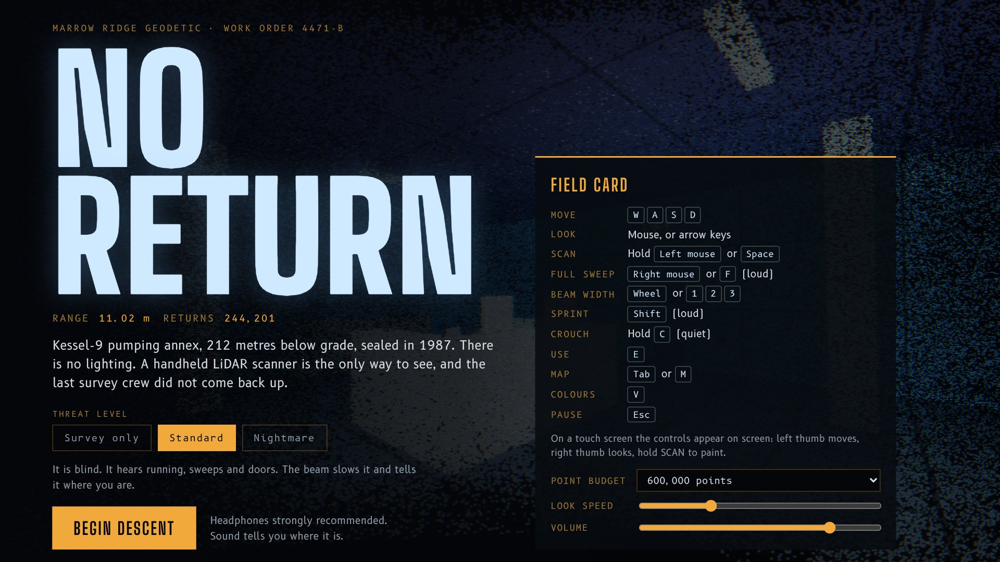
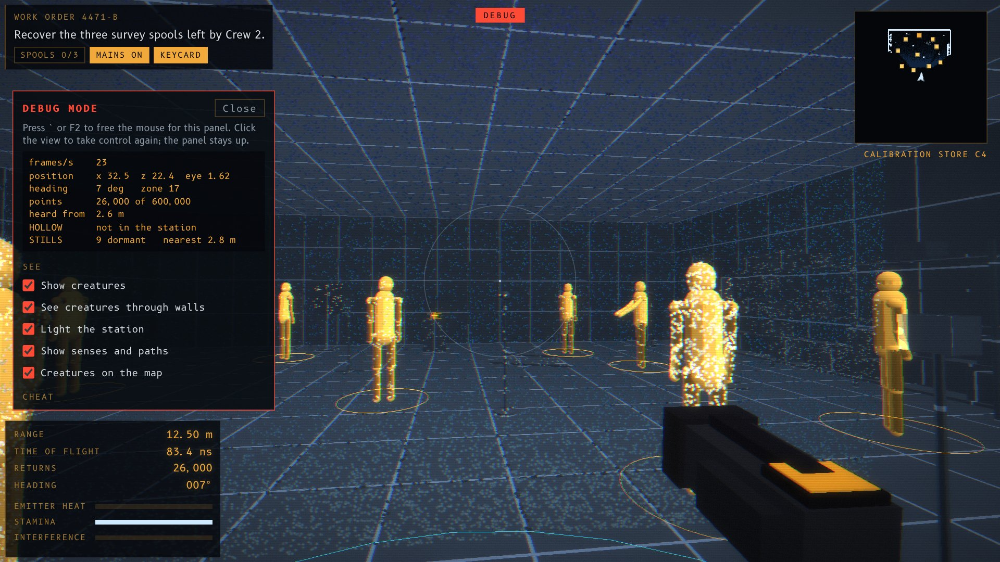

# No Return

A first-person horror game where a handheld LiDAR scanner is the only way to see.


Kessel-9 is a pumping annex 212 metres below grade, sealed in 1987. There is no lighting. You are sent down to recover three survey spools left by the crew before you, and the only thing you ever see is the cloud of points your scanner has painted onto the dark.

Something else is down there. It is never drawn. The only trace of it is the returns a scan leaves on its body, frozen where it stood at that instant. Stop scanning and there is nothing to see, however close it is.

## Play

The repository holds the source. The playable page, `index.html`, is built from it and is one self-contained file: no server needed, and no downloads apart from three web fonts.

With [Node.js](https://nodejs.org) 18 or newer:

```bash
npm run build
```

then open `index.html` in a current desktop or mobile browser.

With Docker, which builds the page and serves it:

```bash
docker build -t no-return .
```

```bash
docker run --rm -p 8080:80 no-return
```

then open http://localhost:8080.

Use headphones. Sound is how you find out where it is.

## Stations

The title screen offers two places to go down into.

**Kessel-9** is the annex as it was built by hand. It is the same every time, and it is the best first descent.

**Uncharted annex** is built fresh for every descent, so knowing the last one does not help you. The lift lobby, the pump hall, the generator, the archive, the calibration store and the shaft are always there, but where they are, what lies between them and which doors need power or the keycard change each time. Fourteen further kinds of room (boiler house, workshop, crew quarters, infirmary, drying room, battery room, sump, old workings and more) fill it out.



- **Size** is small, medium or large: roughly 24, 32 or 41 rooms and corridors. Kessel-9 has 19.
- **Layout** is tight (rooms open straight into rooms), mixed, or sprawling (long corridors).
- **Levels** is one or two. With two, everything behind the keycard, Shaft 9 included, is three metres further down, at the foot of a flight of stairs. Medium and large stations usually get a second, back stair, so the lower level is not a dead end.
- **Seed** decides the station. Leave it empty for a different one every descent. Type a number or a word to get the same station again, or to give a friend the one you played. The seed of the station you are in is shown on the pause and ending screens.

What stays true in every station, so the radio and the notes never lie:

- Generator 2 is always in a room off Pump Hall B, and can be reached without power.
- The keycard is always behind a powered door, and Shaft 9 is always behind a keycard door. In a two-level station that door is at the head of the stairs.
- Doors carry the name of the room behind them above the frame, and long corridors have arrows to the lift and to the pump hall or the shaft.
- The first spool and the keycard are sometimes left in a different room. The note in the security office says where the card is kept.
- Service ducts, one person wide, link parts of the station that are far apart on foot. They are a way out, and a way to be cut off.

## Screenshots

| | |
|---|---|
|  Main corridor A. Wall lettering is retro-reflective and only appears when scanned. |  Calibration store C4. The inventory says nine dummies. |
|  Shaft 9. Pulses aimed past forty metres do not come back. |  The Hollow, caught in the beam. These points are where it was, not where it is. |
|  The map is your own scan seen from above. Unscanned rooms are not on it. |  The title screen scans the lift lobby by itself. |

On a phone the game is played sideways, with the controls on screen. Held upright, it waits and asks you to turn the phone.


## Controls

| Action | Keyboard and mouse | Touch |
|---|---|---|
| Move | `W` `A` `S` `D` | Left thumb |
| Look | Mouse, or arrow keys | Right thumb |
| Scan (paint) | Hold left mouse or `Space` | Hold SCAN and drag |
| Full sweep (loud) | Right mouse or `F` | SWEEP |
| Beam width | Mouse wheel, or `1` `2` `3` | BEAM |
| Sprint (loud) | `Shift` | RUN |
| Crouch (quiet) | Hold `C` | CROUCH |
| Use | `E` | USE |
| Map | `Tab` or `M` | MAP |
| Point colours | `V` | Pause menu |
| Pause | `Esc` | PAUSE |

If the browser will not capture the mouse, hold the mouse button and drag to look.

## How the scanner works

- **Paint** fires a cone of pulses for as long as you hold it. Each pulse that hits something leaves one point. Narrow the beam for detail, widen it to cover ground.
- **Full sweep** rakes the whole view from top to bottom in about two and a half seconds. It is loud, and it costs a lot of emitter heat.
- **Heat** builds while you scan. An overheated emitter shuts off until it cools.
- **Colour** shows distance from where you are standing now: pale close up, deep blue far away. Doors are green when they will open and red when they will not. Amber marks things you can use.
- Points stay where they were measured. A door that has since opened, or a thing that has since walked away, leaves its old points behind until they fade.

<details>
<summary><strong>What hunts you (spoilers)</strong></summary>

**The Hollow** appears once the generator is running.

- It is blind. It hears sprinting, full sweeps, doors and splashing, and at close range it hears you walk. Crouching and standing still is nearly silent.
- The beam slows it to a crawl, and angers it. A quick touch only makes it stop and turn toward the light.
- Keep the beam on it for more than about a second and it knows exactly where you are.
- After about four seconds its anger is full: the beam stops slowing it, and it is faster than you can sprint.
- Anger fades slowly, over half a minute. Light it up again too soon and you have less time than before.
- Once you have touched it with the beam, an AGITATION bar on the scanner shows its anger.
- Wandering near you, it sometimes stops dead and listens. It makes no footsteps then, and it hears better.
- When it loses you it searches ahead in the direction you were heading, and it sometimes pretends to leave.
- It will not enter the calibration store.

**The Stills** are the calibration dummies in store C4.

- They only move while nothing is scanning them.
- A scan shows where each one stood at that moment. Their old outlines linger for a while, so a room can look more crowded, or less, than it is.

**The lift** takes forty seconds to arrive once the spools are uploaded, and the Hollow can hear it from anywhere in the station.

Three threat levels are offered on the title screen. "Survey only" removes everything that hunts you.

</details>

## Debug mode



Debug mode is a tool for building the game, so like [the workshop](#the-workshop) it is not part of `index.html`. It is in the dev build:

```
npm run dev
```

Open the address it prints (http://localhost:4471/) and start a descent. Press `` ` `` (the key left of `1`) or `F2` while playing, or choose "Debug mode" in the pause menu. A panel opens and the game keeps running. Press the key again to free the mouse for the panel; click the view to take control back.

**See**

- **Show creatures** draws the Hollow in red, the Stills in amber and the apparitions in violet. An extra switch shows them faintly through walls.
- **Light the station** draws every wall, floor and object with a line every metre, scanned or not.
- **Show senses and paths** draws a cyan ring for how close the Hollow must be to notice you right now, magenta rings for each noise as it happens, and in yellow the route the Hollow is walking.
- **Creatures on the map** puts their live positions on the minimap and the full map.

**Cheat**

- Cannot be caught, creatures ignore me, freeze creatures, scanner never heats, unlimited sprint.
- **Fly through walls**: `W` and `S` move where you look, `Shift` goes faster. Above the ceilings they disappear, so you can look down into the rooms.

**Do**

- Restore power, give the keycard or all spools, summon, send away or remove the Hollow, wake the Stills, bring the lift, reveal the whole map, clear the point cloud, and jump to any room.

**Live tuning** lists every number from `src/js/00-config.js` and lets you change it while the game runs. Changes are lost on reload, so copy the ones you like into the file.

A run in which debug mode was used says so on the ending screen and does not set a best time.

## The workshop

Numbers in a source file do not show what a room or a body looks like. The workshop does: it is the game's own world, renderer and scanner with the lights switched on, a panel of sliders beside it, and a way to write the result back into `src/`. It is a tool for building the game, so it is not part of `index.html`.

```bash
npm run dev
```

Open the address it prints (http://localhost:4471/) and press **Workshop** on the title screen. The page rebuilds and reloads itself whenever a file in `src/` or `assets/` changes, and comes back exactly where it was: same tool, same room, same camera, unsaved work included. If a source file does not parse, the last good build stays on screen with the file and line of the mistake above it.

**Rooms**

- Any room can be opened and walked around, lit or in the dark. A room written as code can only be looked at, but with the reload that is live tweaking too: change a number in `03-layout.js` or `03-levelgen.js`, save, and the view updates a moment later.
- **New room** starts a room you build by hand. Pick things from the list (tables, lockers, shelf racks, tanks, pipes, plain boxes, wall lettering, water and hazard floor, and so on), click one in the view to select it, drag it across the floor, turn it with `R`, nudge it with the arrow keys, change its sizes with the sliders. `Ctrl+Z` undoes, `Ctrl+D` copies, `Delete` removes.
- Set the room's size and ceiling, where its doors are, which lock tiers it may sit behind, and optionally a spot where a station may leave the first spool or the keycard.
- The checks under the Save button say what would go wrong in a station: something standing just inside a door, no way across the room between two doors, a thing poking through a wall or the ceiling, a spool spot nobody can reach. `N` marks the floor nothing can walk on.
- `L` switches the lights off: the view is then scanned continuously, so you see the room as a player who has scanned all of it would. Space and `F` work the scanner by hand. **From the door** puts you on your feet just inside the first door, which is how a player first sees the room.
- **Save** (`Ctrl+S`) writes `src/rooms/<name>.json`, one line per thing so it reads well in a diff. The build packs these files into the page. A room only turns up in generated stations once "Use this room in generated stations" is ticked; until then it is a draft. Ticking it changes which rooms existing seeds produce, as adding any room does. Run `npm test` afterwards.

**Creatures**

- Every number in `FIGURE_PROPORTIONS_HOLLOW` and `FIGURE_PROPORTIONS_DUMMY` (`src/js/04-figures.js`) has a slider, and the body changes as you drag it. A number added to those objects gets a slider by itself.
- "What it is doing" poses the body with the game's own pose code: roaming, hunting, enraged, standing drawn up to listen, held in the beam, reaching you. "Posed by hand" gives every joint a slider instead.
- Once something is changed, the shape from the file stands beside it in grey, in the same pose. The other creature can be stood beside it for scale, and the pole behind it has a mark every half metre.
- "What the scanner shows" hides the body and leaves only the points a scan puts on it, which is all a player ever sees of it.
- The sliders change the proportions the whole game uses, so you can leave the workshop and meet the result in play. They are remembered across reloads until you press **Write to file** (`Ctrl+S`), which changes only those numbers in `04-figures.js` and leaves the layout and comments of the file alone, or **Back to the file**. A number you change by hand in the file wins over a slider set earlier.

Without the dev server (`node build.js --dev`, then open `build/workshop.html`) everything works except writing into `src/`: Save downloads the room file and "Write to file" copies the changed numbers instead.

## Tweaking the game

Start with `src/js/00-config.js`. Every value there has a comment saying what it does, its unit, and what raising or lowering it changes. For example, `heatFactor` multiplies how fast the scanner heats up on a threat level: at 1.3 you get about 7.7 seconds of continuous painting instead of 10.

For looks and feel that live elsewhere (point colours and size, glow, mouse sensitivity, footstep spacing, door speed, body shapes, sound levels), search the `src/js` folder for `TWEAK`. Each one marks a number that is safe to change and says what it does.

To change rooms, objects or wall lettering, see the short guide at the top of `buildFacilityLayout` in `src/js/03-layout.js`. To see what a change to a room or a body looks like while you make it, use [the workshop](#the-workshop).

Generated stations are tuned at the top of `src/js/03-levelgen.js`: `GENERATED_SIZE_PRESETS` sets how many extra rooms and ducts each size gets, and `GENERATED_LAYOUT_PRESETS` sets how often rooms get corridors and how far from the lift they spread. `STAIR_STEP_COUNT` and `STAIR_STEP_HEIGHT` set how long and steep the stairs are, and so how deep the lower level is. To add a kind of room, build it in [the workshop](#the-workshop), or write a `furnish...` function for it there (the room's north-west corner is at 0, 0) and add one entry to `ROOM_CATALOGUE` with its size, the places a door may go, and which lock tiers it may sit behind. Keep the floor just inside each door clear. Then run `npm test`: it builds 120 stations and reports any that cannot be walked or finished.

After any change:

```bash
npm run build
```

## Voice lines

Dispatch's radio lines and the three survey spools can be voiced. Record them clean, drop the files into `assets/voice/`, and build; the game adds the bad-radio sound itself. [`docs/voice-lines.md`](docs/voice-lines.md) lists every line with its file name and how to say it. Lines without a recording stay text only.

## Under the hood

The game is plain JavaScript and WebGL 2 with no libraries and no asset files.

| File | What it does |
|---|---|
| `src/js/00-config.js` | Every tuning value (each one explained), difficulty presets and all story text |
| `src/js/01-math.js` | Small math helpers and 4×4 matrices |
| `src/js/02-world.js` | Tile grid, props, signs, doors, collision, navigation, occluder mesh |
| `src/js/03-layout.js` | Every hand-built room with its props, signs and pickups, and how Kessel-9 puts them together |
| `src/js/03-levelgen.js` | Generated stations: the extra rooms, the room catalogue, the planner, locks, ducts and signs |
| `src/js/03-workshop-rooms.js` | Rooms made in the workshop: what they can contain, and how a file in `src/rooms/` becomes a catalogue room |
| `src/js/04-figures.js` | The capsule bodies used for everything that stands upright |
| `src/js/05-raycast.js` | What one laser pulse hits, and how far away |
| `src/js/06-renderer.js` | Point cloud, depth-only world, scanner model, post-processing |
| `src/js/07-audio.js` | Every sound, synthesised with the Web Audio API |
| `src/js/08-entities.js` | Doors, the Hollow, the Stills and the apparitions |
| `src/js/09-player.js` | Keyboard, mouse and touch input, movement, the scanner |
| `src/js/10-interface.js` | HUD, map, messages and overlay screens |
| `src/js/11-game.js` | Objectives, checkpoints, death, ending and the main loop |
| `src/js/12-debug.js` | The little the game itself knows about debug mode: switches that are all off, and hooks that stay empty |
| `src/js/13-start.js` | One line that starts the game once everything above is loaded |
| `src/rooms/*.json` | Rooms made in the workshop, one file each (the folder appears with the first one you save) |
| `src/dev/` | Debug mode (`10-debug.js`: the panel, its switches and what they draw) and the workshop. Only in the `npm run dev` build, never in `index.html` |
| `tools/dev-server.js` | `npm run dev`: builds, serves, reloads the page when the source changes, and writes what the workshop saves |

A few details worth knowing if you change things:

- A station is a grid of one-metre tiles carved into rooms (128 × 112 at most; Kessel-9 uses 76 × 64 of it), plus boxes, cylinders and spheres for everything standing in them. The same data drives the ray caster, collision, path finding and the black geometry that hides points behind walls.
- Each room is described once, at its place in Kessel-9. A generated station moves and turns the same descriptions, so a room is the same room wherever it ends up.
- The two levels of a generated station lie side by side on the plan, not one above the other, joined by stairs that really go down. That keeps the map a single flat drawing and the path finding simple. Every tile has its own floor height; anything that walks can take a step of up to 45 cm, and stands on whatever floor is under it.
- A generated station is planned as rectangles first: rooms are attached to free doorways of rooms already placed, either wall to wall or at the end of a new corridor. Rooms that need power are only ever attached to what can be reached without it or to each other, and likewise for the keycard, so the locks always come in an order that can be finished. Only then is anything built.
- Walls, floors and props are drawn into the depth buffer only, never in colour. Creatures are not drawn at all.
- Creatures are built from capsules (rods with rounded ends): 25 for the Hollow, down to three long fingers on each hand, and 24 for a dummy. The Hollow's pose follows its mood: hunched when wandering, reaching when it hunts, drawn up to its full height when it stops to listen.
- Sound is synthesised live, mostly from noise shaped by filters. The Hollow's growl is a recorded-in-code rattle of clicks pushed through three resonances, the way a throat and chest shape a voice.
- Points live in a ring buffer on the graphics card (250,000 to 1,000,000 depending on the quality setting). The oldest points are overwritten first.
- Points left on a creature carry a lifetime and fade; points on the station are permanent.

## Building and testing

The game needs nothing to run. The tooling needs [Node.js](https://nodejs.org) 18 or newer.

```bash
npm run build
```

rebuilds `index.html` from `src/`. The file is not kept in the repository, so it can never be out of step with the source.

```bash
npm install
```

```bash
npx playwright install chromium
```

```bash
npm test
```

plays the whole objective chain in a headless browser and checks each step: leaving the lift, the generator, the Hollow's path finding, the beam holding it, both ways to die, checkpoints, powered and keycard doors, the Stills, the lift call, the ending, that the game itself has no debug mode in it, every debug mode switch in the dev build, and the turn-your-phone-sideways screen.

It then builds 120 generated stations (40 of each size, across the three layouts, half with one level and half with two) and checks each one: nothing unreachable, every door usable from both sides, every objective within arm's reach, the generator reachable without power, the keycard with power only, and the shaft only with the card. It checks that a seed always gives the same station, walks down a flight of stairs on foot, and plays one two-level station from lift to lift, which includes the Hollow climbing the stairs from the shaft. Set `GENERATED_SEEDS` to try more, for example `GENERATED_SEEDS=300 node tools/generated-station-test.js`.

It ends with the workshop: on a copy of `src/` in a temporary folder it builds a room by clicking and dragging, saves it, finds it again in generated stations, changes a creature's proportions and writes them to the file, and checks that the page survives a source file that does not parse.

```bash
npm run dev
```

starts the dev build, with [debug mode](#debug-mode) and [the workshop](#the-workshop). `npm run dev -- --port 5000` uses another port.

```bash
npm run audio-check
```

measures every sound, because a test cannot listen: how loud each one is and where its energy sits, and it fails if one is silent or loud enough to distort. It cannot tell you whether a sound is good. Only ears can.

```bash
npm run voice-script
```

rewrites `docs/voice-lines.md` from the text in `src/js/00-config.js`. Run it after changing what dispatch or the spools say.

```bash
npm run screenshots
```

regenerates the pictures in `docs/screenshots/`. It renders in software and takes around ten minutes. Name one or more pictures to retake only those, for example `node tools/take-screenshots.js hollow phone`.

## Status

The rules are covered by the scripted test above. The test teleports between objectives, so it shows that the game can be finished, not that the chases are fair or the pacing is right. Balance values in `src/js/00-config.js` were chosen by reasoning and have had little real play. Expect to tune them.

Generated stations are proven finishable, not proven good. Nobody has yet walked one from end to end with the Hollow hunting. They have more doors than Kessel-9, and every door you open makes noise, so they may play harder. The stairs are checked for being walkable, by you and by what hunts you, but how a chase up or down them feels is untested. Kessel-9 itself is still one level.
