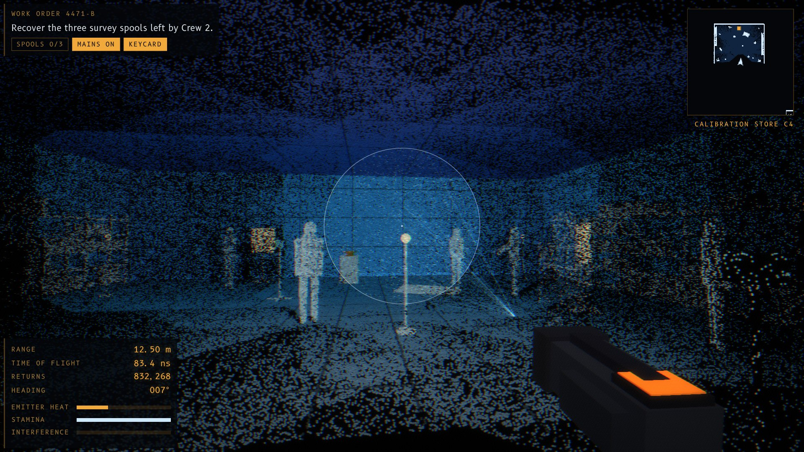
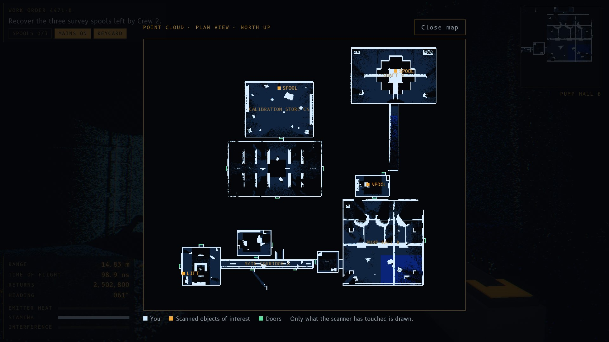
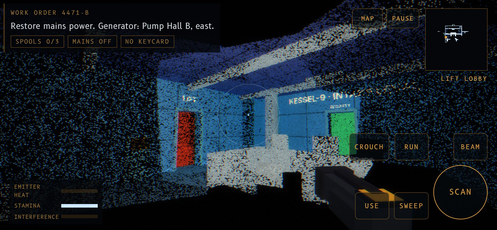

# [Last Return](https://last-return.sknol.com)

A first-person horror game where a handheld LiDAR scanner is the only way to see.


Kessel-9 is a pumping annex 212 metres below grade, sealed in 1987. There is no lighting. You are sent down to recover three survey spools left by the crew before you, and the only thing you ever see is the cloud of points your scanner has painted onto the dark.

Something else is down there. It is never drawn. The only trace of it is the returns a scan leaves on its body, frozen where it stood at that instant. Stop scanning and there is nothing to see, however close it is.

## Play

The repository holds the source. The playable page, `index.html`, is built from it and is one self-contained file: no server needed, and no downloads apart from three web fonts.

With [Node.js](https://nodejs.org) 18 or newer:

```bash
npm run build
```

then open `index.html` in a current desktop or mobile browser.

With Docker, which builds the page and serves it:

```bash
docker build -t last-return .
```

```bash
docker run --rm -p 8080:80 last-return
```

then open http://localhost:8080.

Use headphones. Sound is how you find out where it is.

## Stations

The title screen offers two places to go down into.

**Kessel-9** is the annex as it was built by hand. It is the same every time, and it is the best first descent.

**Uncharted annex** is built fresh for every descent, so knowing the last one does not help you. The lift lobby, the pump hall, the generator, the archive, the calibration store and the shaft are always there, but where they are, what lies between them and which doors need power or a keycard, and what else you are asked to do down there, change each time. Fourteen further kinds of room (boiler house, workshop, crew quarters, infirmary, drying room, battery room, sump, old workings and more) fill it out.


- **Size** is small, medium, large or massive: roughly 25, 33, 45 or 60 rooms and corridors. Kessel-9 has 19. Size also sets the number of keycards (one, one, two, three) and how many extra jobs dispatch gives you (see below).
- **Layout** is tight (rooms open straight into rooms), mixed, or sprawling (long corridors).
- **Levels** is one or two. With two, everything behind the last keycard, Shaft 9 included, is further down, at the foot of a flight of stairs; how long and how steep the flight is depends on the seed. Medium and large stations usually get a second, back stair, so the lower level is not a dead end.
- **Seed** decides the station, its locks and its jobs. Leave it empty for a different one every descent. Type a number or a word to get the same station again, or to give a friend the one you played. The seed of the station you are in is shown on the pause and ending screens.

What stays true in every station, so the radio and the notes never lie:

- Generator 2 is always in a room off Pump Hall B, and can be reached without power.
- The first keycard is always behind a powered door, and Shaft 9 is always behind the last keycard's door. In a two-level station that door is at the head of the stairs.
- With more than one keycard the station is a set of rings: keycard 1 opens the first ring of doors and is how you reach keycard 2, and so on inwards. A higher card opens the lower doors too, and a locked door tells you which card it wants. Dispatch tells you when the card you picked up is not the last one, and the map shows how many you hold.
- Doors carry the name of the room behind them above the frame, and long corridors have arrows to the lift and to the pump hall or the shaft.
- The first spool and the first keycard are sometimes left in a different room. The note in the security office says where that card is kept.
- Service ducts, one person wide, link parts of the station that are far apart on foot. They are a way out, and a way to be cut off.
- Vents do the same at crawl height: a low opening in a wall with the grille lying on the floor in front of it. You only fit crouched (hold `C` and walk in), you are slow in there, and sheet metal is loud. The Hollow uses them too, on its knees and hands, and you can hear it doing so from a long way off. A vent never leads past a lock: both ends are always behind the same doors.

## Screenshots

| | |
|---|---|
|  Main corridor A. Wall lettering is retro-reflective and only appears when scanned. |  Calibration store C4. The inventory says nine dummies. |
|  Shaft 9. Pulses aimed past forty metres do not come back. |  The Hollow, caught in the beam. These points are where it was, not where it is. |
|  The map is your own scan seen from above. Unscanned rooms are not on it. |  The title screen scans the lift lobby by itself. |

On a phone the game is played sideways, with the controls on screen. Held upright, it waits and asks you to turn the phone.



## Controls

| Action | Keyboard and mouse | Touch |
|---|---|---|
| Move | `W` `A` `S` `D` | Left thumb |
| Look | Mouse, or arrow keys | Right thumb |
| Scan (paint) | Hold left mouse or `Space` | Hold SCAN and drag |
| Full sweep (loud) | Right mouse or `F` | SWEEP |
| Beam width | Mouse wheel, or `1` `2` `3` | BEAM |
| Sprint (loud) | `Shift` | RUN |
| Crouch (quiet), crawl into vents | Hold `C` | CROUCH |
| Use | `E` | USE |
| Map | `Tab` or `M` | MAP |
| Point colours | `V` | Pause menu |
| Pause | `Esc` | PAUSE |

If the browser will not capture the mouse, hold the mouse button and drag to look.

The screen is quiet by default: there is the dark, the points and the aiming ring. The objective shows for a few seconds when it changes, the heat and stamina meters only while they are in use, and everything else is on the map screen (`Tab` or `M`). "Full instruments" in the settings puts the range readouts, the minimap and all the meters back, as in the pictures here.

## Captions

The lines in square brackets at the bottom of the screen. **Captions** in the settings (title screen and pause menu) has three levels:

| Level | What you get |
|---|---|
| **Off** | No captions. You go by your ears. |
| **Tells** | Only what the Hollow has just done: `[it has found you]`, `[it has lost you]`, `[it is moving off]`, `[it turns toward the light]`, `[the beam no longer holds it]`. A new game starts here. |
| **Every sound** | The tells, and every sound that matters, each with an arrow to where it comes from and how near it is. For playing without hearing the game. |

Messages are not captions and always show: a locked door, lift control, a hint, and everything Dispatch says.

On **every sound**:

- Each line ends in an arrow and a word: `[heavy footsteps] ← near`. The arrow pointing up is straight ahead of you, down is behind. The word is `close` (under 5 m), `near` (under 12 m) or `far`. Both follow the sound as it moves and as you turn.
- A caption only shows where its sound could be heard. Each has a distance, worked out from how loud the sound measures: the Hollow's calm growl carries about 6 m, its footsteps 10, a door 26, its roar 50. Walls do not stop sound in this game, so they do not stop a caption.
- A sound that goes on is one steady line for as long as it lasts. The Hollow's footsteps are one line and its voice another, so when it stops dead to listen the footsteps line goes and the growl stays. That is the same tell ears get.
- Never more than four lines. When there are more, the ones that say least make way.
- A door you open yourself gets no caption. A door that opens somewhere else does: nothing but you and what hunts you opens doors.

<details>
<summary><strong>Every caption (spoilers)</strong></summary>

| Caption | When |
|---|---|
| `[it has found you]` | It starts to hunt you, with the stinger. Tell. |
| `[it has lost you]` | It gives up the chase and starts to search. Tell. |
| `[it is moving off]` | A breather begins while it is within 22 m. Tell. |
| `[it turns toward the light]` | The beam first touches it while it is not hunting. Tell. |
| `[the beam no longer holds it]` | Its anger is full. Tell. |
| `[a low, rattling growl]` / `[growling, loud and fast]` | It is near: calm, or hunting. |
| `[it roars]` | It finds you again too soon after the last time for the stinger. |
| `[it snarls]` / `[it sniffs the air]` / `[a short, rising trill]` | While it hunts / while it searches / it heard something and goes to look. |
| `[it shrieks in the beam]` | Held in the beam and angry. |
| `[heavy footsteps]` / `[heavy footsteps, fast]` | It walks / it hunts. |
| `[sheet metal booms: something is in a vent]` | It crawls through a vent. |
| `[something crawls overhead]` | It is above the ceiling. |
| `[a ceiling hatch rattles]` | It goes into an open hatch, or is about to drop out of one. |
| `[a ceiling hatch is forced open]` / `[a ceiling hatch bursts open]` | The first time it goes in through a hatch / comes out of one. |
| `[it is at the door]` / `[it is at the door again]` / `[it is at the door again. The door will not hold]` | It pounds on a door: untouched, battered, about to go. |
| `[the door gives way]` | The door breaks. |
| `[a door opens]` / `[a door closes]` | A door more than 3.5 m from you. |
| `[glass crunches under something]`, `[a floor plate clanks under something]`, `[cans scatter, and not by you]` | The Hollow sets off a noisy patch of floor. |
| `[glass crunches under your boots]`, `[a floor plate clanks under you]`, `[cans scatter from your feet]` | You do. |
| `[something shifts]` | One of the Stills moves. |
| `[a breath behind you]` | The apparition that stands behind you. |
| `[water drips]`, `[a pipe groans]`, `[metal ticks as it settles]`, `[knocking, far below]` | The station. |
| `[the lift bell rings]` | The lift is on its way down, or has arrived. |
| `[your heart is pounding]` | Something is pressing you hard. |

</details>

Not captioned: your own footsteps, the scanner, the hum of the generator and the lift machinery, and the stingers. The stance, heat and interference meters and the lift countdown already show those.

## How the scanner works

- **Paint** fires a cone of pulses for as long as you hold it. Each pulse that hits something leaves one point. Narrow the beam for detail, widen it to cover ground.
- **Full sweep** rakes the whole view from top to bottom in about two and a half seconds. It is loud, and it costs a lot of emitter heat.
- **Heat** builds while you scan. An overheated emitter shuts off until it cools.
- **Colour** shows distance from where you are standing now: pale close up, deep blue far away. Doors are green when they will open and red when they will not. Amber marks things you can use.
- **The warning colour on the floor** means the floor there is loud: broken glass, a loose plate, empty cans. Walk round it, or crouch across it.
- Points stay where they were measured. A door that has since opened, or a thing that has since walked away, leaves its old points behind until they fade.

<details>
<summary><strong>What hunts you (spoilers)</strong></summary>

**The Hollow** appears once the generator is running.

- It is blind. It hears sprinting, full sweeps, doors and splashing, and at close range it hears you walk. Crouching and standing still is nearly silent.
- The beam slows it to a crawl, and angers it. A quick touch only makes it stop and turn toward the light.
- Keep the beam on it for more than about a second and it knows exactly where you are.
- After about four seconds its anger is full: the beam stops slowing it, and it is faster than you can sprint.
- Anger fades slowly, over half a minute. Light it up again too soon and you have less time than before.
- Once you have touched it with the beam, an AGITATION bar on the scanner shows its anger.
- Wandering near you, it sometimes stops dead and listens. It makes no footsteps then, and it hears better.
- When it loses you it searches ahead in the direction you were heading, and it sometimes pretends to leave.
- Something paces it. Left alone, its wandering closes in on you room by room over a minute or so. Once it has pressed you hard, by chasing you or by prowling close for a long time, it goes off to the far side of the station and stays there for at least 25 seconds.
- That pacing is fair by rule. It is never told where you are, only which room to walk to, and never a room closer than four metres' walk. Finding you still takes its ears or your beam. It is never called off in the middle of a chase, and when it has earned you a breather it does not pretend to leave and come back.
- Noise you make during a breather still brings it.
- The further you get, the harder it presses: each spool you carry makes it close in sooner and cuts the breathers shorter, though never below twelve seconds.
- It crawls through vents. It is slower in them, and the metal booms under it, which is the warning you get.
- It is taller than most of the station's ceilings. It bends to fit under whatever is over it, ducks through doorways, and draws itself up to the ceiling when it stops to listen.
- It will not enter the calibration store.
- It has no keycard. A door that opens by itself opens for it, and so does a powered door once the mains is on. A keycard door never opens for it, and neither does the lift door. It gets through one of those only while it stands open for you, so a keycard door closing behind you is a real way to break a chase.
- It has its own way round: the **crawlspace** above the ceilings. Every part of the station that keycard doors close off has at least one ceiling hatch, which shows in a scan in the warning colour. A hatch starts shut, a flat square in the ceiling. The first time the Hollow goes up or comes down through one it forces the cover with a bang you hear from a long way off, and from then on that cover hangs down: an open hatch is one it has been through. The Hollow reaches up into one, crawls, and drops out of another.
- That way round is slow and loud. You hear it thumping overhead, from where it is, all the way. The hatch it is about to come out of rattles for two and a half seconds before it drops, and for its first second on the floor it cannot catch you. Up there a scan finds nothing, and it cannot reach down.
- Before it goes round, it goes at the door. Hunting you, with a keycard door shut in its face that you hold the card for, it walks up to it and **pounds** on it for a few seconds. A door takes two bouts of that. In the third it gives way for good: the slab lies in the doorway and the opening stays open for the rest of the descent. Angry, it hits harder and the door goes sooner. So a door will save you twice. Each blow lands heavier on a door it has battered before, and with captions on "every sound" the line says so in words: at the door, at the door again, and when that door will not hold.
- It only goes at a door you could open yourself, so a door it breaks was never one that kept you out, and it cannot be baited into opening a lock for you. The lift door cannot be broken.
- It only goes up when walking is much further or impossible. In Kessel-9, getting round one shut keycard door to a player nine metres away on the other side takes it a little under forty seconds.

**The Stills** are the calibration dummies in store C4.

- They only move while nothing is scanning them.
- A scan shows where each one stood at that moment. Their old outlines linger for a while, so a room can look more crowded, or less, than it is.

**Apparitions** are figures that are only in the point cloud. They cannot touch you. A few stand at fixed places, there the first time you walk into their room. The rest come by chance, at a place chosen at that moment from where you are standing and which way you are looking, so no two descents have them in the same spots, and a seed does not fix them.

- **The watcher** stands some way off, facing you, at the end of a corridor or the far side of a room. Gone once you have had a proper look, or if you walk toward it.
- **Behind you.** A breath at your back. Turn and scan, and something is reaching for you from a few metres away. Gone almost as soon as the scan finds it.
- **The dummy.** One of the calibration mannequins, standing where none should be. Scan it and look away, and it is closer. Look away again and it is gone.
- **The crosser** walks across the far end of whatever you are scanning, from one side to the other, and does not come back.
- **The crawler** is on its knees and hands in the mouth of a vent, looking out into the room. Only in stations that have vents.
- **In your face.** About one scan in a hundred, at most once a descent and never in the first two minutes, you start a scan and it is bent down right in front of you. It is gone a moment later.

Three things keep them fair, and are worth knowing:

- They are silent. Everything real in the station makes its own noise; an apparition never borrows one. The breath is the only sound they have. They also scan in the colour of the walls, not in the Hollow's colour.
- They belong to the quiet stretches. None comes while the Hollow is hunting, searching or near, or while the Stills are close, and one that is out vanishes the moment that changes. When something real is happening, everything the scanner shows you is real.
- They are rare: about four in Kessel-9, up to ten in a massive station. One you never scanned does not count. A descent shows you as many different kinds as it can before it repeats one.

**Noisy things on the floor** are broken glass, a loose floor plate and a spill of empty cans. Each is one square metre of floor, and in a scan it shows in the warning colour.

- Walk over one and the Hollow hears it from eight metres on Standard, where it hears a walking step from a little over three. Run over one and it hears it from fifteen, where a running step carries eleven. It comes to look at that spot. (On Nightmare, where it hears further: eleven and a half metres, and twenty-two.)
- **Crouched, you cross one without a sound.** That is the whole trick, and the first one you set off tells you so.
- It goes off the moment you step onto it, and again with every footstep you take on it. It never wears out. Shuffling about on its edge does not set it off again: you have to get clear of it and come back.
- The Hollow sets them off too. It does not care. You should: a crunch of glass two rooms away, with nobody else down here, tells you where it is. With captions on "every sound" a line says so as well, from as far as it can be heard: `[glass crunches under something]`.
- About half of them lie where you have to walk, in corridors and a step or two inside doors. The rest lie anywhere. Never on a doorstep, on stairs, in water, over a pit or a grate, in a vent, in the lift or its lobby, or under your feet at something you have to use.
- Kessel-9 has eight. A generated station has about two for every five rooms and corridors, never two within six metres of each other. The seed decides where, so the same seed has them in the same places.

**The lift** takes forty seconds to arrive once the spools are uploaded, and the Hollow can hear it from anywhere in the station.

**Quests** are what a descent asks of you besides power, the spools and the lift. They only come up in the Uncharted annex; the seed decides which a station has. A quest holds up one of three moments: Generator 2 starting, the lift terminal taking the spools, or the lift coming after it has.

| Quest | What it asks | Holds up |
|---|---|---|
| **No fuel** | Generator 2's day tank is empty. A fuel can stands in a room near it that you can reach without power. | The mains |
| **Core samples** | Two to four grey sample tubes, one to a room, anywhere short of the last keycard's doors. | The upload |
| **More generators** | One to three small generators that the lift winch needs. See below. | The upload |
| **Crew badges** | Two or three badges of Crew 2, each clipped to a hard hat left on a crate. | The upload |
| **Isolation valves** | Two or three valves to drive shut. They need the mains, and their actuators squeal: on Standard the Hollow hears one from 14 m. Dispatch marks them on your map once you have taken a keycard. | The upload |
| **The winch breaker** | The upload goes through, but the lift does not come until the breaker is closed. The panel is behind a powered door, Dispatch marks it, and the forty seconds start there. Close it earlier and the upload calls the lift as usual. | The lift |

How many a station has depends on its size. The first, second and last come from one draw (a small station has none or one of them, a medium one, a large one or two, a massive two or three). Badges and valves come from a second draw (small none, medium and large none or one, massive one or two). The generators are counted by themselves. A massive station can have all six, and that is a long descent.

**More generators.** A generated station may also have one to three small generators besides Generator 2: Generator 1, 3 and 4, each a set on a skid standing in some room short of the last keycard's doors. A small station has none or one, a medium one up to two, a large one or two, a massive one to three.

- Generator 2 still restores the mains, and still wakes what is in the shaft. The small ones only start once the mains is on, so they are always started with the Hollow about.
- The lift winch needs every one of them. Until they all run, the lift terminal refuses the upload and says how many do. A little after Generator 2 starts, Dispatch tells you and marks them on your map.
- **Starting one is loud.** On Standard the Hollow hears it from 24 m and comes to look at that generator; within 7 m of it, it knows where you are. Start it and be somewhere else.
- About half of them have an empty tank. The fuel can for one stands in the nearest room that has space, usually ten to twenty-five metres' walk away, and never behind a door the generator is not behind itself.
- Any can fills any tank, and you carry one can at a time.

What you are carrying for a quest, and how far along each one is, is listed on the map with the spools and the keycards.

**The map marks what you have found in two ways.** Bright: something you can act on now (a spool, a keycard, a core sample, a generator that will start, a fuel can while some tank is empty). Dim and smaller: found, but not of use yet (a note, a small generator before the mains is on or without its fuel, the lift terminal while it would only refuse). Nothing you have found is ever hidden.

Three threat levels are offered on the title screen. "Survey only" removes everything that hunts you.

A fourth, **Custom**, lets you set each thing yourself. Choose it and a panel opens (the **Adjust** button opens it again). It starts as a copy of Standard, and "Start from" copies one of the other two.

| Setting | What it changes |
|---|---|
| The Hollow, The Stills | On or off. |
| Hollow speed | 70 to 140 %. Above about 130 % it hunts faster than you sprint, and the panel says so. |
| Hollow hearing | 50 to 160 %: from how far it hears a step, a sweep, a door. |
| How hard it presses | 50 to 200 %: how soon it closes in again after a breather, and how short the breather is. |
| Its temper in the beam | 50 to 200 %: how fast the beam angers it, so how long you can hold it before it knows where you are. |
| Scanner heat | 50 to 200 %: how fast the scanner heats up. |
| Your stamina | 50 to 200 %: how long a full bar lasts. |
| Apparitions | None, few, normal or many. "None" also removes the ones that stand at fixed places. |
| Checkpoints | Off is one life: being caught ends the descent. |

Each row says what its value comes to in play ("It hunts at 3.9 m/s. You sprint at 4.6."), worked out from the numbers in `src/js/00-config.js`, and rows that differ from Standard are lit. The title screen and the ending screen name the differences in one line. Best times are kept apart for every different set of values. A threat level, custom or not, never changes what a station looks like: a seed builds the same station on all of them.

</details>

## Reporting a problem

The title screen and the pause screen say which build you are playing: the version, the build number (how many commits it was built from) and the commit, with a `+` after it if the source had changes that were not committed. The ending screen says it too.

**Report a problem** on either screen opens a bug report on GitHub with that line, the station, its seed and options, the threat level, the room you are standing in and your browser already filled in. Nothing is sent until you submit the form.

A Docker build has no git to ask, so the image only carries the build number and the commit if you pass them in:

```bash
docker build --build-arg LAST_RETURN_BUILD_NUMBER=$(git rev-list --count HEAD) --build-arg LAST_RETURN_BUILD_COMMIT=$(git rev-parse --short=7 HEAD) -t last-return .
```

Without them the game shows the version alone.

A server can say what it is called, and the game then puts that in front of "How you played" in the report. Give the container `LAST_RETURN_SERVER_NAME`, or the Helm chart `serverName`:

```bash
helm upgrade last-return ./chart --namespace last-return --reset-then-reuse-values --set serverName="Official server"
```

The name is written into the page when the container starts. Left out, a report gives the address alone.

## Debug mode


Debug mode is a tool for building the game, so like [the workshop](#the-workshop) it is not part of `index.html`. It is in the dev build:

```
npm run dev
```

Open the address it prints (http://localhost:4471/) and start a descent. Press `` ` `` (the key left of `1`) or `F2` while playing, or choose "Debug mode" in the pause menu. A panel opens and the game keeps running. Press the key again to free the mouse for the panel; click the view to take control back.

**See**

- **Show creatures** draws the Hollow in red, the Stills in amber and the apparitions in violet. An extra switch shows them faintly through walls.
- **Light the station** draws every wall, floor and object with a line every metre, scanned or not.
- **Show senses and paths** draws a cyan ring for how close the Hollow must be to notice you right now, magenta rings for each noise as it happens, and in yellow the route the Hollow is walking.
- **Creatures on the map** puts their live positions on the minimap and the full map.

**Cheat**

- Cannot be caught, creatures ignore me, freeze creatures, scanner never heats, unlimited sprint.
- **Fly through walls**: `W` and `S` move where you look, `Shift` goes faster. Above the ceilings they disappear, so you can look down into the rooms.

**Do**

- Restore power, give the keycard or all spools, summon, send away or remove the Hollow, wake the Stills, bring the lift, reveal the whole map, clear the point cloud, and jump to any room.
- **Apparition**: pick a kind and summon it where you stand. Each kind wants its own sort of place (the crosser a crossing in view, the crawler a vent), and the game says so if there is none. The readout shows how many this descent has had, and why none may come right now.

**Live tuning** lists every number from `src/js/00-config.js` and lets you change it while the game runs. Changes are lost on reload, so copy the ones you like into the file.

A run in which debug mode was used says so on the ending screen and does not set a best time.

## The workshop

Numbers in a source file do not show what a room or a body looks like. The workshop does: it is the game's own world, renderer and scanner with the lights switched on, a panel of sliders beside it, and a way to write the result back into `src/`. It is a tool for building the game, so it is not part of `index.html`.

```bash
npm run dev
```

Open the address it prints (http://localhost:4471/) and press **Workshop** on the title screen. The page rebuilds and reloads itself whenever a file in `src/` or `assets/` changes, and comes back exactly where it was: same tool, same room, same camera, unsaved work included. If a source file does not parse, the last good build stays on screen with the file and line of the mistake above it.

**Rooms**

- Any room can be opened and walked around, lit or in the dark. A room written as code can only be looked at, but with the reload that is live tweaking too: change a number in `03-layout.js` or `03-levelgen.js`, save, and the view updates a moment later.
- **New room** starts a room you build by hand. Pick things from the list (tables, lockers, shelf racks, tanks, pipes, plain boxes, wall lettering, water and hazard floor, and so on), click one in the view to select it, drag it across the floor, turn it with `R`, nudge it with the arrow keys, change its sizes with the sliders. `Ctrl+Z` undoes, `Ctrl+D` copies, `Delete` removes.
- Set the room's size and ceiling, where its doors are, which lock tiers it may sit behind, and optionally a spot where a station may leave the first spool or the keycard.
- The checks under the Save button say what would go wrong in a station: something standing just inside a door, no way across the room between two doors, a thing poking through a wall or the ceiling, a spool spot nobody can reach. `N` marks the floor nothing can walk on.
- `L` switches the lights off: the view is then scanned continuously, so you see the room as a player who has scanned all of it would. Space and `F` work the scanner by hand. **From the door** puts you on your feet just inside the first door, which is how a player first sees the room.
- **Save** (`Ctrl+S`) writes `src/rooms/<name>.json`, one line per thing so it reads well in a diff. The build packs these files into the page. A room only turns up in generated stations once "Use this room in generated stations" is ticked; until then it is a draft. Ticking it changes which rooms existing seeds produce, as adding any room does. Run `npm test` afterwards.

**Creatures**

- Every number in `FIGURE_PROPORTIONS_HOLLOW` and `FIGURE_PROPORTIONS_DUMMY` (`src/js/04-figures.js`) has a slider, and the body changes as you drag it. A number added to those objects gets a slider by itself.
- "What it is doing" poses the body with the game's own pose code: roaming, hunting, enraged, standing drawn up to listen, held in the beam, reaching you. "Posed by hand" gives every joint a slider instead.
- Once something is changed, the shape from the file stands beside it in grey, in the same pose. The other creature can be stood beside it for scale, and the pole behind it has a mark every half metre.
- "What the scanner shows" hides the body and leaves only the points a scan puts on it, which is all a player ever sees of it.
- The sliders change the proportions the whole game uses, so you can leave the workshop and meet the result in play. They are remembered across reloads until you press **Write to file** (`Ctrl+S`), which changes only those numbers in `04-figures.js` and leaves the layout and comments of the file alone, or **Back to the file**. A number you change by hand in the file wins over a slider set earlier.

**Sounds**

- Every sound the game makes has a row: a button for a sound that plays once, a tick box for one that goes on (room tone, the growl, static, the generator), so you can hear one sound against another. **Play all in turn** goes through the whole list.
- Sounds that come from somewhere (the Hollow, doors, machinery, drips) are put straight ahead of you, at the distance the slider says. The cross in the hall marks the spot.
- After a sound has played, its row shows three numbers, all measured where the sound leaves the compressor, which is what reaches the speakers. **loud** is how loud it is to an ear at its loudest moment, in decibels below the most the speakers can do (ten less is about half as loud, and deep rumble counts for little, as it does in your head). **peak** is how large the wave got at the speakers, of 1.0. **held** is how many decibels the compressor took off it. Rest the mouse on the numbers for the whole story. These are the numbers `npm run audio-check` prints.
- Red means the peak is over 1.0 (or nothing came out). A speaker cuts such a wave off flat, which gives the sound a harsh edge, and from there a higher number adds edge, not loudness. Whether that edge is wanted is yours to judge. Amber means a big wave for how little of it is heard: most of the sound is very low (a heartbeat, knocking from the shaft, a blow on a door), and ears and small speakers make little of that, so it hits the ceiling long before it gets loud. More of the sound between 150 and 600 Hz helps; more level does not.
- The compressor is the last thing every sound goes through. It holds little back: the loudest sounds lose 2 to 5 decibels. Its two numbers are `SOUND_OUTPUT`, just under `SOUND_LEVELS`; the board has both as controls to try by ear (what you try there is not kept).
- How loud each sound is, is set in `SOUND_LEVELS`, the table at the top of `src/js/07-audio.js`: one multiplier per sound, where 1 is the sound as built and 2 doubles the signal (one clear step louder, not twice as loud). Under each sound's name is which number is its own and what it is now. Change it and the page reloads with the list where you left it, so the loop is: change, save, press the button again.
- `npm run audio-check -- --listen` starts the dev server and opens this tool directly. So does an address ending in `#sounds`.
- To add a sound to the list, add a line to `SOUND_BOARD_ENTRIES` in `src/dev/23-workshop-sounds.js`. It is then measured by `npm run audio-check` as well.

Without the dev server (`node build.js --dev`, then open `build/workshop.html`) everything works except writing into `src/`: Save downloads the room file and "Write to file" copies the changed numbers instead.

## Tweaking the game

Start with `src/js/00-config.js`. Every value there has a comment saying what it does, its unit, and what raising or lowering it changes. For example, `heatFactor` multiplies how fast the scanner heats up on a threat level: at 1.3 you get about 7.7 seconds of continuous painting instead of 10.

How the Hollow is paced is the block headed "The director" there: how fast menace builds, how long a breather lasts, how near its wandering may be steered. Debug mode's readout shows the director's phase, the menace level and the band of rooms it is currently choosing from.

How bent the Hollow is has two values there: `hollowBaseStoop` (how bent it always is) and `hollowCeilingGap` (how much room it keeps over its head, so how deeply it ducks under low ceilings and doors). Its size is in `FIGURE_PROPORTIONS_HOLLOW`, best changed in the workshop; whatever size you give it, it fits itself to the ceilings.

For looks and feel that live elsewhere (point colours and size, glow, mouse sensitivity, footstep spacing, door speed, body shapes), search the `src/js` folder for `TWEAK`. How loud each sound is, is in one table: `SOUND_LEVELS` at the top of `src/js/07-audio.js`, best tuned with [the sound board](#the-workshop). Each one marks a number that is safe to change and says what it does.

Every caption is one line in `CAPTIONS` in `src/js/00-config.js`: what it says, whether it is a tell or a sound, from how far it shows, how long it stays, and which captions it shares a line with. If you make a sound louder in `SOUND_LEVELS`, it carries further; `npm run audio-check` prints a **heard to** distance for every sound that comes from somewhere, which is the number to put in that caption's `withinMetres`. To caption a new sound, add a line to the table and call `showCaption('itsName', whereItComesFrom)` next to the line that plays the sound.

**Adding a quest** is one entry in `QUESTS` in `src/js/09-quests.js`; the top of that file explains every field. The entry says what kind it is (`collect`: take things; `activate`: switch machines on; `supply`: bring something to a machine that is already there), what it holds up, how many things it has, which ring of rooms they stand in, what builds one of them, and every sentence it uses. Nothing else needs to change: which stations get it, placing, the rules, the objective line, the count on screen, the marks on the map, the terminal's refusal and the check that it can be finished all come from the entry. The crew badges are 14 lines there and the isolation valves 20, plus a few lines each in `src/js/03-layout.js` for what the thing looks like. A quest draws its random numbers from a sequence of its own, so adding one moves nothing in any existing station.

How many quests a size of station gets is in `GENERATED_SIZE_PRESETS` at the top of `src/js/03-levelgen.js`: `extraJobs`, `errands` and `extraGenerators`, each a fewest and a most. Set both to 0 and that draw gives none.

**When Dispatch speaks** is the table `DISPATCH_CUES` in `src/js/00-config.js`: something that happens, the line he says, how many seconds after. What can happen includes the Stills of a room waking (`stillsWake`) and you setting foot in a room for the first time (`enter:PUMP HALL B`), so a line can go with a place and not with how far along you are. A line about a quest is with its quest instead (`tell`). None of the quest lines names a number, so one recording does for every station; the number is on screen.

To change rooms, objects or wall lettering, see the short guide at the top of `buildFacilityLayout` in `src/js/03-layout.js`. To see what a change to a room or a body looks like while you make it, use [the workshop](#the-workshop).

Generated stations are tuned at the top of `src/js/03-levelgen.js`: `GENERATED_SIZE_PRESETS` sets how many extra rooms and ducts each size gets, and `GENERATED_LAYOUT_PRESETS` sets how often rooms get corridors and how far from the lift they spread. `STAIR_STEP_COUNT` and `STAIR_STEP_HEIGHT` set how long and steep the stairs are, and so how deep the lower level is. Each size's `vents` is how many vents it tries to fit; `VENT_HEIGHT` in `src/js/02-world.js` is how high they are inside. To add a kind of room, build it in [the workshop](#the-workshop), or write a `furnish...` function for it there (the room's north-west corner is at 0, 0) and add one entry to `ROOM_CATALOGUE` with its size, the places a door may go, and which lock tiers it may sit behind. Keep the floor just inside each door clear. Then run `npm test`: it builds 120 stations and reports any that cannot be walked or finished.

After any change:

```bash
npm run build
```

## Voice lines

Dispatch's radio lines and the three survey spools can be voiced. Record them clean, drop the files into `assets/voice/`, and build; the game adds the bad-radio sound itself. [`docs/voice-lines.md`](docs/voice-lines.md) lists every line with its file name and how to say it. Lines without a recording stay text only.

## Under the hood

The game is plain JavaScript and WebGL 2 with no libraries and no asset files.

| File | What it does |
|---|---|
| `src/js/00-config.js` | Every tuning value (each one explained), difficulty presets and all story text |
| `src/js/01-math.js` | Small math helpers and 4×4 matrices |
| `src/js/02-world.js` | Tile grid, props, signs, doors, collision, navigation, occluder mesh |
| `src/js/03-layout.js` | Every hand-built room with its props, signs and pickups, and how Kessel-9 puts them together |
| `src/js/03-levelgen.js` | Generated stations: the extra rooms, the room catalogue, the planner, locks, ducts and signs |
| `src/js/03-noisy-floor.js` | Noisy things on the floor: the kinds, where a station gets them, what stepping on one does |
| `src/js/03-workshop-rooms.js` | Rooms made in the workshop: what they can contain, and how a file in `src/rooms/` becomes a catalogue room |
| `src/js/04-figures.js` | The capsule bodies used for everything that stands upright |
| `src/js/05-raycast.js` | What one laser pulse hits, and how far away |
| `src/js/06-renderer.js` | Point cloud, depth-only world, scanner model, post-processing |
| `src/js/07-audio.js` | Every sound, synthesised with the Web Audio API |
| `src/js/08-crawlspace.js` | The Hollow and locked doors: which doors are shut to it, the ceiling hatches, its way round above the ceilings |
| `src/js/08-entities.js` | Doors, the Hollow and its director, the Stills |
| `src/js/08-phantoms.js` | The apparitions: each kind, and the part that decides when one comes |
| `src/js/09-difficulty.js` | Threat levels: turns the "Custom" settings into the same kind of record a preset is |
| `src/js/09-quests.js` | Quests: every quest described once, and the code that places them, runs their rules and checks them |
| `src/js/09-player.js` | Keyboard, mouse and touch input, movement, the scanner |
| `src/js/10-interface.js` | HUD, map, messages, captions and overlay screens |
| `src/js/11-game.js` | Objectives, checkpoints, death, ending and the main loop |
| `src/js/12-debug.js` | The little the game itself knows about debug mode: switches that are all off, and hooks that stay empty |
| `src/js/13-start.js` | One line that starts the game once everything above is loaded |
| `src/rooms/*.json` | Rooms made in the workshop, one file each (the folder appears with the first one you save) |
| `src/dev/` | Debug mode (`10-debug.js`: the panel, its switches and what they draw) and the workshop with its room, creature and sound tools. Only in the `npm run dev` build, never in `index.html` |
| `tools/dev-server.js` | `npm run dev`: builds, serves, reloads the page when the source changes, and writes what the workshop saves |

A few details worth knowing if you change things:

- A station is a grid of one-metre tiles carved into rooms (128 × 112 at most; Kessel-9 uses 76 × 64 of it), plus boxes, cylinders and spheres for everything standing in them. The same data drives the ray caster, collision, path finding and the black geometry that hides points behind walls.
- Each room is described once, at its place in Kessel-9. A generated station moves and turns the same descriptions, so a room is the same room wherever it ends up.
- The two levels of a generated station lie side by side on the plan, not one above the other, joined by stairs that really go down. That keeps the map a single flat drawing and the path finding simple. Every tile has its own floor height; anything that walks can take a step of up to 45 cm, and stands on whatever floor is under it.
- A generated station is planned as rectangles first: rooms are attached to free doorways of rooms already placed, either wall to wall or at the end of a new corridor. Rooms that need power are only ever attached to what can be reached without it or to each other, and likewise for the keycard, so the locks always come in an order that can be finished. Only then is anything built.
- Everything in a generated station follows from its seed through one numbered sequence of random draws. A shuffle is done by giving each item a drawn number and sorting on that number. The shorter way, sorting with a coin toss as the comparison, makes the result depend on how the browser happens to run the sort, and then one seed gives different stations on different days.
- Walls, floors and props are drawn into the depth buffer only, never in colour. Creatures are not drawn at all.
- Creatures are built from capsules (rods with rounded ends): 25 for the Hollow, down to three long fingers on each hand, and 24 for a dummy. The Hollow's pose follows its mood: hunched when wandering, reaching when it hunts, drawn up to its full height when it stops to listen.
- Sound is synthesised live, mostly from noise shaped by filters. The Hollow's growl is a recorded-in-code rattle of clicks pushed through three resonances, the way a throat and chest shape a voice.
- Points live in a ring buffer on the graphics card (250,000 to 1,000,000 depending on the quality setting). The oldest points are overwritten first.
- Points left on a creature carry a lifetime and fade; points on the station are permanent, except those on a door, which fade once it slides away (`doorImprintSeconds`).

## Building and testing

The game needs nothing to run. The tooling needs [Node.js](https://nodejs.org) 18 or newer.

```bash
npm run build
```

rebuilds `index.html` from `src/`. The file is not kept in the repository, so it can never be out of step with the source.

```bash
npm install
```

```bash
npx playwright install chromium
```

```bash
npm test
```

plays the whole objective chain in a headless browser and checks each step: leaving the lift, the generator, the Hollow's path finding, the beam holding it, the director's fairness rules (never steered closer than its floor, never called off mid-chase, a real breather afterwards, noise still brings it), both ways to die, checkpoints, powered and keycard doors, the Stills, the lift call, the ending, that the game itself has no debug mode in it, every debug mode switch in the dev build, and the turn-your-phone-sideways screen.

It then builds 120 generated stations (40 of each size, across the three layouts, half with one level and half with two) and checks each one: nothing unreachable, every door usable from both sides, every objective within arm's reach, the generator reachable without power, each keycard only with the one before it, the shaft only with the last, and the fuel can, the core samples and the winch breaker where their rules say they must be. It checks that a seed always gives the same station (also after the browser has warmed up, which is what once broke it), plays the rules of each extra job, builds eight massive stations with three keycards each, walks down a flight of stairs on foot, tries a vent standing (no) and crouched (yes), sends the Hollow through it, and plays one two-level station from lift to lift, whatever extra job that station has, which includes the Hollow climbing the stairs from the shaft. Set `GENERATED_SEEDS` to try more, for example `GENERATED_SEEDS=300 node tools/generated-station-test.js`.

Then the Hollow and locked doors: each kind of door with the Hollow standing at it (the keycard door and the lift door stay shut, even with every card in your pocket), a keycard door shut between it and you (it never walks through, goes round through the crawlspace, and takes the time the numbers say: the climb, the metres, the full warning), a look from straight underneath it (a scan finds nothing and it cannot reach down), the landing (under the hatch that rattled, harmless for its first second), a keycard door held open by you (it simply walks through), pounding on a door (one bout, the door holds, it leaves that door alone for a while; the second bout adds to the damage; the third breaks it and it comes straight through; the broken door stays open and can be walked over; no pounding without the card, none on the lift door, harder when angry, and it stops if the door opens), short walks from under a hatch (it never takes to the ceiling for those), the lift car, the hatches being shut until it has been through them (the one it climbs into is forced as it goes in, the one it comes out of only as it drops, the rest stay shut, and a new descent shuts them all), and the hatches themselves. The 120 generated stations are each checked too: every locked-off part has a hatch, the Hollow can reach everywhere it may go, and without the crawlspace it really is shut in.

Then the quest system: every quest is described completely (kind, what it holds up, sentences, lines Dispatch really has); 64 stations with whatever quests their seeds gave them can each be finished; each size gets as many as its ranges allow; no two things share an object number; three stations have their fuel cans, core samples, breaker and generators exactly where they stood before the quest system existed. Then a made-up quest is added as one more entry while the test runs: it turns up in every station, not one thing of any other quest moves, the terminal refuses for it, it can be done, and the upload then goes through. Then the badges and the valves are played by their rules, Dispatch's fuel line is said once for a small generator, "Do not stay in that room" comes with the Stills waking, and a line tied to a room is said the first time you enter it and not the second.

Then the generators: 64 stations of every size have as many small generators as their size allows, each still finishable, each fuel can near its generator (half within 25 steps, none over 60; for Generator 2 half within 30, none over 45), and the same seed gives the same ones. Then the rules in one station: a small generator will not start before the mains is on or with an empty tank; any can fills any tank and a second can is refused while you carry one; Dispatch tells you and marks them; the lift terminal refuses while one is not running; starting one brings a Hollow twelve metres off to that generator, and one four metres off straight at you; with all running the lift is called; a new descent puts everything back. The map's bright and dim marks are checked at each step.

Then the noisy things on the floor: Kessel-9 and a generated station get the number the size calls for, of more than one kind, none in a bad place, and the same seed puts them in the same places. Then a patch is walked over with the Hollow standing far enough away that it could not have heard a footstep (it comes to look at that very spot, and you are told what it was), crossed again crouched with the Hollow three and a half metres off (nothing carries, it does not stir), run over with the Hollow further away than a running step carries, and walked over by the Hollow itself (once or twice in a crossing; made to shuffle to and fro over the edge for three seconds, it sets it off once, not thirty times; with you two metres away a line on screen says so, and with you at the lift none does). The 120 generated stations each have theirs checked for being in a place they are allowed.

Then the captions: every caption the game asks for is in the table and every one in the table is used; a new game starts on "tells", both menus change the level, and it is kept between visits; off shows none, tells shows only the tells, every sound shows all; each caption shows just inside its distance and not just outside it; the arrow is right in all eight directions and follows both a sound that moves and a player who turns; the growl waits for a snarl on the line they share; a sound that goes on is one steady line; there are never more than four. Then each caption is made to happen in play, from the Hollow wandering past (footsteps and growl; footsteps gone when it stops to listen) to a door it opens eight metres away, the Stills, the breath, the lift bell, the station's own sounds and a vent in a generated station. The locked-door and noisy-floor tests run with captions on every sound and check theirs.

Then the Custom threat level: the panel opens and closes, a moved control changes the setting and the sentence beside it, the values survive closing the page, bad stored values are put right, a descent plays by what was set, heat, temper, stamina and apparitions each change by the factor asked for, one life really offers no checkpoint, and the ending names the descent as custom and keeps its best time apart.

Then the apparitions. Where and when they come is chance, so nothing there trusts one lucky try: each kind is summoned from about two thousand standing places in three stations and every one must be where its rules allow (in range, in sight, on good floor, never popping into the beam). Each kind is then played through: the watcher scanned, approached and ignored; the one behind you turned on and not turned on; the dummy coming closer and going; the crosser waiting, walking and vanishing; the crawler in its vent; the one in your face with loaded dice, with its limit, and switched off. Two long quiet walks check the timing (none too soon, never two at once, never the same kind twice running, never more than the descent is allowed), and a last part checks that none comes while the Hollow hunts or is near, and that one that is out goes when a hunt starts.

It ends with the workshop: on a copy of `src/` in a temporary folder it builds a room by clicking and dragging, saves it, finds it again in generated stations, changes a creature's proportions and writes them to the file, and checks that the page survives a source file that does not parse.

Every pull request gets both: `.github/workflows/ci.yml` builds the page as it ships and runs `npm test`, on a machine that draws a good deal slower than a desktop. A check that only passes on a fast machine is a check that depends on the clock, and fails there.

```bash
npm run dev
```

starts the dev build, with [debug mode](#debug-mode) and [the workshop](#the-workshop). `npm run dev -- --port 5000` uses another port.

```bash
npm run audio-check
```

measures every sound, because a test cannot listen: how loud each one is to an ear, how large its wave is at the speakers, how much the compressor held it back, where its energy sits, and for a sound that comes from somewhere, how far away it can still be heard (the distance its caption should have). It fails only if one is silent. It then lists, for you to judge, the sounds whose wave is over what a speaker can take, and the ones with a big wave that an ear hears little of. It takes about three minutes; name one or more sounds to measure only those, for example `npm run audio-check -- hollow door`. It cannot tell you whether a sound is good. Only ears can:

```bash
npm run audio-check -- --listen
```

measures nothing and opens the workshop's [sound board](#the-workshop) in your browser instead, where every sound is on a button. `--port 5000` uses another port.

```bash
npm run voice-script
```

rewrites `docs/voice-lines.md` from the text in `src/js/00-config.js`. Run it after changing what dispatch or the spools say.

```bash
npm run screenshots
```

regenerates the pictures in `docs/screenshots/`. It renders in software and takes around ten minutes. Name one or more pictures to retake only those, for example `node tools/take-screenshots.js hollow phone`.

## Status

The rules are covered by the scripted test above. The test teleports between objectives, so it shows that the game can be finished, not that the chases are fair or the pacing is right. Balance values in `src/js/00-config.js` were chosen by reasoning and have had little real play. Expect to tune them.

The director's rules are checked, and its rhythm was measured with scripted players who cannot hear or scan, which is not the same as playing against it. Whether a breather feels like relief or like the game going slack is for a real playthrough to decide.

Generated stations are proven finishable, not proven good. Nobody has yet walked one from end to end with the Hollow hunting. They have more doors than Kessel-9, and every door you open makes noise, so they may play harder. The stairs and the vents are checked for being passable, by you and by what hunts you, but how a chase through them feels is untested. Vents are only in generated stations. Kessel-9 itself is still one level.

The locked doors and the crawlspace are checked for their rules and their timings. Whether half a minute overhead is the right price for a door, whether the thumps tell you enough about where it is going, and whether the rattle is enough warning, need ears and play. The numbers are in `src/js/00-config.js` under "The crawlspace", and the two sounds are on the sound board. How many bouts a door should take, and whether the pounding frightens or only delays, need play: `hollowDoorDamagePerBout` in the same place sets it (0.34 is three bouts, 0.5 two, 0 never). Dispatch has one new line for the first broken door (`doorBroken`), not yet recorded. Not done: you cannot lock or bar a door yourself. The Stills still open the doors of their own rooms.

The noisy things on the floor are checked for where they lie and for what stepping on them does. Nobody has heard them: the three sounds were tuned by measuring, not by ear, and are on the sound board to be listened to and changed. How many is right, and whether half of them in the walking lines is a hazard or a nuisance, need play. The numbers are in `src/js/00-config.js` under "Noisy things on the floor", and how often each kind turns up is at the top of `src/js/03-noisy-floor.js`.

The captions are checked for what shows when and where. Whether "every sound" is enough to play by has not been tried by anyone who cannot hear the game, and that is the only test that counts. The distances come from measurements of each sound alone in silence, down to the level of the room tone; with the growl and a heartbeat going, ears lose the quiet ones sooner than the captions do. The wording, the three distance words and the limit of four lines are first guesses.

The apparitions keep to their rules, which is what the test can show. How often is right, whether the dummy that comes closer frightens or annoys, and whether the one in your face reads as a face or only as a mass of points a metre away, need playing. All their numbers are in `src/js/00-config.js` under "Apparitions", and debug mode can summon each kind where you stand.

The quest system is checked for doing what each entry says, and for leaving every older station as it was. What it cannot check is the sum: a massive station can now ask for six things besides the spools, and nobody has played one. The numbers that set that are the three ranges in `GENERATED_SIZE_PRESETS`. The badges and the valves are new and unplayed; the valve's squeal was tuned by measuring. Three of Dispatch's lines for quests have no recording yet (`generatorsWanted`, `badgesWanted`, `valvesWanted`), and `allSpools.mp3` still says "all three" where the text now says "all of them".

The small generators are checked for their rules and for where they and their cans stand. Whether two or three of them make a descent tenser or only longer has not been played, and neither has how loud "loud" should be: `noiseRadiusGeneratorStart` in `src/js/00-config.js` is a first guess. Their two sounds were tuned by measuring, not by ear. Dispatch's line for them (`generatorsWanted`) has no recording yet.

The extra jobs and the stations with two or three keycards are checked the same way: they can always be finished, and the rules do what this page says. Whether a second walk for a fuel can is dread or a chore has not been played. Dispatch's five new lines for them (`lowerKeycardTaken`, `generatorNoFuel`, `coresWanted`, `winchBreakerOpen`, `breakerClosed`) have no recordings yet and show as text.

## License

The code and everything else in this repository is [MIT](LICENSE), with one exception.

The voice recordings in `assets/voice/` are not under the MIT licence. They were generated with ElevenLabs and are here so the game can play them. They remain subject to [ElevenLabs' terms](https://elevenlabs.io/terms-of-use) and [use policy](https://elevenlabs.io/use-policy), which among other things do not allow using them to train an AI model. If you fork the game and want different voices, [record your own](#voice-lines).
