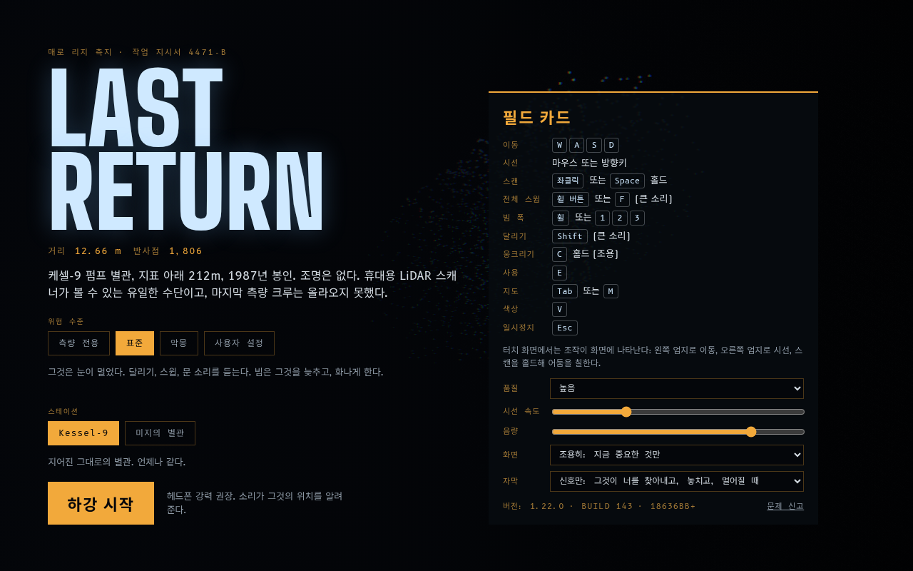
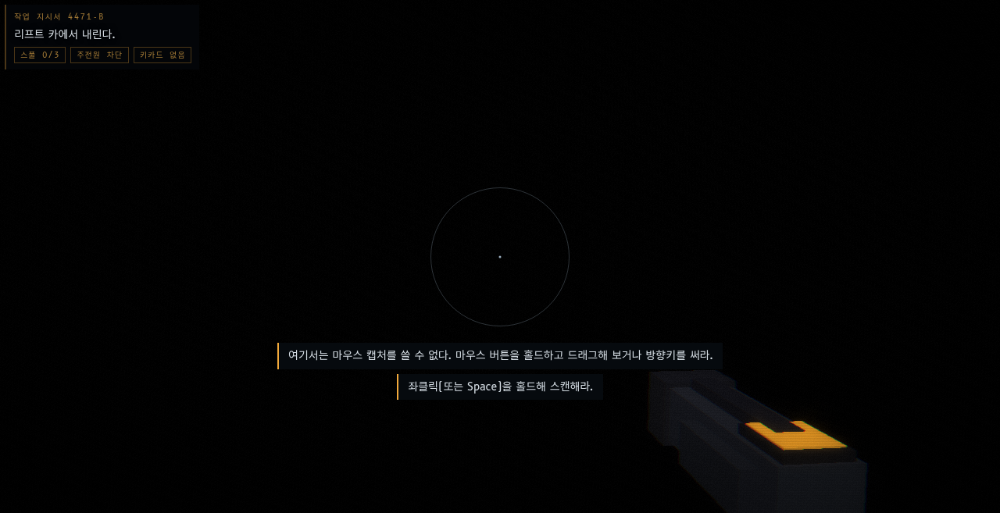
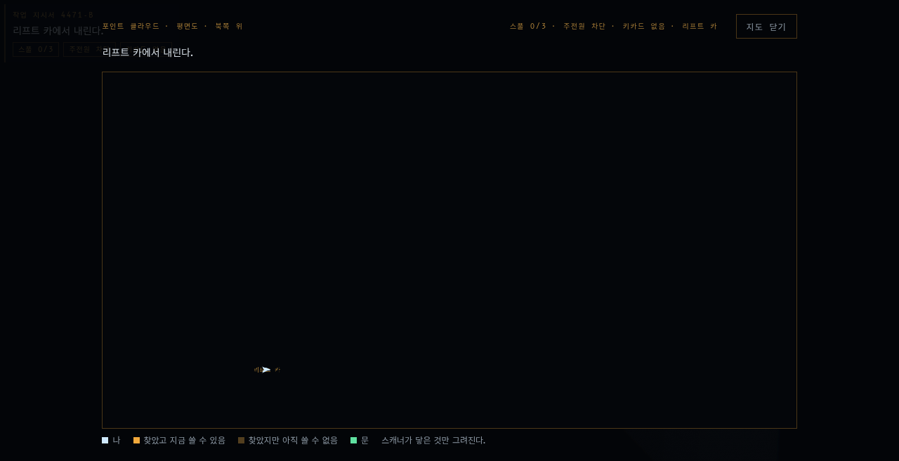
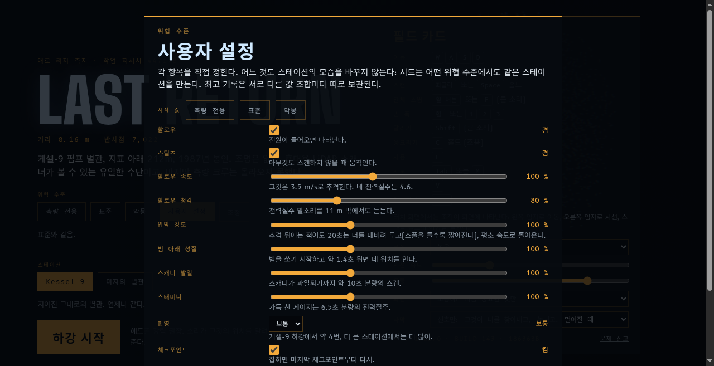

# 라스트 리턴 (Last Return) — 한국어판

[StefanKnol/Last-Return](https://github.com/StefanKnol/Last-Return)의 한국어 로컬라이제이션입니다.

케셀-9 펌프 별관, 지표 아래 212m. 1987년에 봉인된 스테이션에 조명은 없다. 휴대용 LiDAR 스캐너가 볼 수 있는 유일한 수단이고, 마지막 측량 크루는 올라오지 못했다. 스캔으로 어둠을 칠하고, 측량 스풀을 회수하고, 리프트가 오기까지 살아남아라.

## 플레이

브라우저에서 바로 실행됩니다: **https://sigco3111.github.io/last-return-ko/**

데스크톱(마우스+키보드)과 터치 화면을 모두 지원합니다. 헤드폰 권장.

## 특징

- 포인트 클라우드 LiDAR 스캐닝: 스캔한 것만 보이는 완전한 어둠
- 소리로 움직이는 눈먼 것, 할로우. 빔은 그것을 늦추지만 화나게 한다
- 매번 달라지는 생성 스테이션(미지의 별관)과 손으로 만든 클래식 스테이션(Kessel-9)
- 측량 전용 / 표준 / 악몽 / 사용자 설정 난이도
- 라디오 교신, 쪽지, 벽의 낙서까지 전부 한국어

## 스크린샷









## 로컬에서 실행

```sh
node build.js   # src/를 묶어 자급자족 index.html 하나로 빌드
```

빌드된 `index.html`을 브라우저로 열면 됩니다. 별도 서버가 필요 없습니다.

## 한국어화 노트

- UI, 목표, 라디오 메시지, 자막, 로그, 퀘스트 문구, 벽 표지와 낙서를 한국어로 옮겼습니다.
- 방 이름은 내부적으로 영어를 유지합니다(게임 로직이 이름을 비교하기 때문). 플레이어에게 보이는 곳(지도, HUD, 벽 표지)만 `koZoneName()`으로 한국어를 입힙니다.
- 한글 글꼴은 Noto Sans KR을 추가했습니다. 원작 글꼴(Big Shoulders Display, B612)은 라틴 문자에 그대로 쓰입니다.
- 원작의 버그 리포트 링크는 원작 저장소의 이슈 양식을 그대로 가리키며, 자동 기입값(빌드, 스테이션, 시드)은 원작 개발자가 읽을 수 있도록 영어로 둡니다.

## 라이선스와 원작

- 원작: [Last Return](https://github.com/StefanKnol/Last-Return) by Stefan Knol
- 원작 라이선스: MIT — `LICENSE` 파일을 그대로 유지합니다.
- 이 한국어판도 같은 MIT 라이선스를 따릅니다.
- 원작에 포함된 라디오 음성 파일은 별도의 라이선스 조건이 있는 자산으로, 이 저장소에 포함하지 않습니다. 음성이 없는 대사는 자막으로만 표시됩니다(원작이 음성 파일이 없는 대사를 그렇게 처리합니다).
